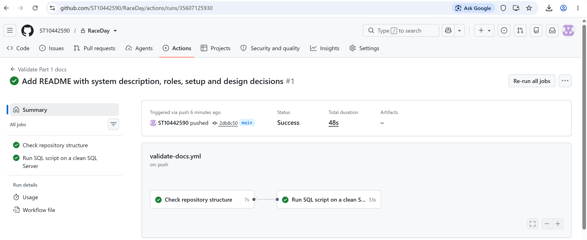
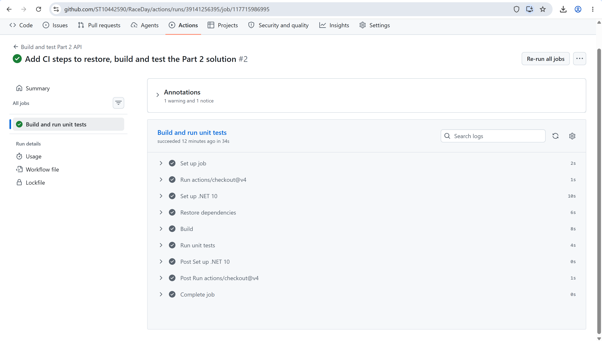
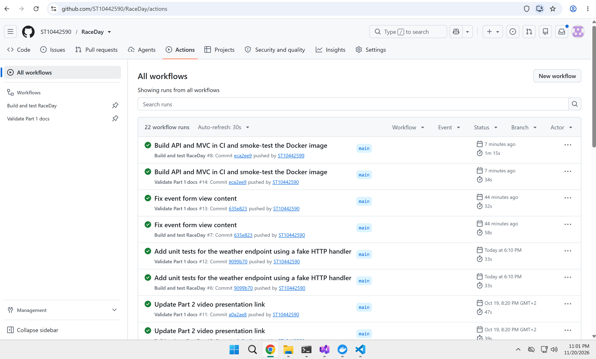

# RaceDay

RaceDay is a web-based event management system for the South African road running, walking and cycling community. Organisers create and manage events, categories and results; participants browse upcoming events, enter them, track their personal results, and check live weather and route information before race day.

This repository is built in three parts for PROG6212 (Programming 2B):

| Part | Scope | Status |
|---|---|---|
| 1 | System planning: ERD, API endpoint plan, SQL database script | ✅ Complete |
| 2 | RESTful API in C#, session authentication, unit tests, GitHub Actions CI | ✅ Complete |
| 3 | ASP.NET Core MVC front end, Azure Blob Storage, Docker | ✅ Complete |

## Roles

**Organiser** – registers an account; creates, edits and deletes their own events; manages each event's age and distance categories; views everyone enrolled in their events; captures and corrects participant results.

**Participant** – registers an account; browses and filters events; enters an event by choosing a category; views their own enrolments; tracks their personal finish times and positions; manages their profile.

An Organiser can only manage events they created. Attempting to change another Organiser's event returns **403 Forbidden**.

## Repository structure

```
/docs                        Part 1 planning documents
  RaceDay_ERD.png            Entity Relationship Diagram
  API_Endpoint_Plan.md       Every planned endpoint with role, body and responses
  RaceDay.sql                Creates RaceDayDB, all tables, constraints and seed data
  ci-green-build.png         Part 1 CI screenshot
  ci-part2-green-build.png   Part 2 CI screenshot
  ci-part3-green-build.png   Part 3 CI screenshot

/Part2-API                   Part 2 solution
  RaceDay.Part2.slnx
  RaceDay.Api/               ASP.NET Core Web API
    Controllers/             Auth, Users, Events, Categories, Enrolments, Results, EventTypes,
                             EventImages (Azure Blob Storage), EventWeather (Open-Meteo)
    Data/                    DbContext, design-time factory, seed data
    Migrations/              EF Core Code-First migrations
    Models/                  Entities and request/response DTOs
    Security/                Session helpers and the role filter
    Services/                Azure Blob Storage image service
  RaceDay.Api.Tests/         33 xUnit tests

/Part3-MVC                   Part 3 front end
  RaceDay.Web/               ASP.NET Core MVC app that consumes the API
    Controllers/             Home, Events, Account, Participant, Organiser, Categories, Entries
    Services/ApiClient.cs    The only class that talks to the API
    Security/                MVC session helpers and the [RoleRequired] page filter
    Views/                   Razor views, Bootstrap 5 with the RaceDay theme
    Dockerfile               Multi-stage build for the MVC container

RaceDay.slnx                 Whole solution: API, tests and MVC

/.github/workflows
  validate-docs.yml          Checks /docs and runs the Part 1 SQL script on a clean SQL Server
  build-and-test.yml         Builds the API and MVC, runs all unit tests, builds and smoke-tests the Docker image
```

---

# Part 1 – System planning

## Setup

1. Install SQL Server (Developer or Express) and SQL Server Management Studio.
2. Open `docs/RaceDay.sql` in SSMS, connected to your server.
3. Press **Execute (F5)**. The script drops any existing `RaceDayDB`, recreates it, creates all 7 tables and a results view, and inserts the seed data.
4. The final two `SELECT` statements show row counts per table and the results board.

> **Note:** Part 2 manages `RaceDayDB` through EF Core migrations. Running the Part 1 script again will drop the database the API depends on. If you do, recreate it with `dotnet ef database update` from `Part2-API/RaceDay.Api`.

## Design decisions

- **7 entities:** Roles, Users, EventTypes, Events, EventCategories, Enrolments, Results.
- **Users ↔ EventCategories is many-to-many**, resolved by the `Enrolments` junction table, which records the Participant, the Event and the selected Category. A composite foreign key makes sure the category belongs to that event.
- **Results is one-to-zero-or-one with Enrolments**: a result can only exist for someone who entered.
- **Categories can be age-based or distance-based** (e.g. Under 20, Senior, 10km, 21km), set by `CategoryType`.
- **Organisers capture finish time and finishing position** in `Results`; DNF/DNS/DQ results have neither.
- **Lookup tables** (Roles, EventTypes) instead of free text keep values consistent.

### Differences between the ERD and the SQL script
None.

## CI/CD

The workflow checks that `/docs` holds the ERD, endpoint plan and SQL script, then starts a clean SQL Server 2022 container and runs `RaceDay.sql` to prove it executes without errors.



## Video presentation

Part 1 walkthrough: **https://youtu.be/9dK51eOxbsc**

---

# Part 2 – RESTful API

## Technology

- ASP.NET Core Web API (.NET 10) with controllers
- Entity Framework Core 10, Code-First, against SQL Server
- Server-side session authentication with ASP.NET Core Identity password hashing
- Swagger (Swashbuckle) for browsing and testing every endpoint
- xUnit with the EF Core in-memory provider for unit tests

## Setup and run

**Prerequisites:** .NET 10 SDK, SQL Server (Express or Developer), and the EF Core tools (`dotnet tool install --global dotnet-ef`).

1. Check the connection string in `Part2-API/RaceDay.Api/appsettings.json`. The default is:
```
   Server=.\SQLEXPRESS;Database=RaceDayDB;Trusted_Connection=True;TrustServerCertificate=True
```
2. Create the database from the migrations:
```
   cd Part2-API/RaceDay.Api
   dotnet ef database update
```
3. Run the API:
```
   dotnet run
```
4. Open the Swagger UI at the address shown in the console, with `/swagger` on the end — for example `http://localhost:5120/swagger`.

The database is seeded on first run with 2 organisers, 3 participants, 3 events, 7 categories, 6 enrolments and 3 results.

**Demo accounts** — every seeded account uses the password `RaceDay#2026`:

| Role | Email |
|---|---|
| Organiser | `lerato.mokoena@raceday.co.za` |
| Organiser | `johan.vanwyk@raceday.co.za` |
| Participant | `sipho.dlamini@gmail.com` |
| Participant | `aisha.patel@outlook.com` |
| Participant | `thandi.nkosi@gmail.com` |

**Organiser invite code:** `RACEDAY-ORG-2026` (set in `appsettings.json` under `RaceDay:OrganiserInviteCode`).

## Trying the API in Swagger

Swagger holds the session cookie between calls, so the sequence below works end to end:

1. `POST /api/auth/login` with an email and password from the table above.
2. `GET /api/auth/session` — returns the user id and role held in the session.
3. `GET /api/events/mine` — as an Organiser, lists only their own events.
4. `DELETE /api/events/2` as Lerato — returns **403**, because event 2 belongs to Johan.
5. `POST /api/auth/logout`, then any protected endpoint — returns **401**.

## Authentication and role-based access

The brief and the Part 2 rubric call for session management rather than tokens, so:

- **Login** verifies the password and stores the user's id and role in a server-side session. The browser only receives an opaque, HttpOnly cookie; no user data travels in it.
- **Passwords** are hashed with `PasswordHasher<User>` (PBKDF2). The plain text is never stored, and a unit test asserts this.
- **`[RequireRole]`**, a custom authorisation filter in `Security/RequireRoleAttribute.cs`, protects every non-public endpoint. With no roles listed it allows any logged-in user; with roles listed it allows only those. It returns **401** when nobody is logged in and **403** for the wrong role.
- **Ownership** is checked separately from role: an endpoint may allow all Organisers, then compare the event's `OrganiserId` against the session before allowing a change.
- **Organiser registration** requires an invite code, so event management cannot simply be claimed by anyone registering. Participant registration is open.

### Deviation from the Part 1 plan
The Part 1 endpoint plan specified JWT bearer tokens. Part 2 uses server-side sessions instead, to meet the requirement that *"the application must make use of session management to maintain the user's authenticated state and role"*. The endpoints, roles and status codes are otherwise as planned.

## Endpoints

All routes are under `/api`. Full details, including request bodies and failure codes, are in [`docs/API_Endpoint_Plan.md`](docs/API_Endpoint_Plan.md) and in the Swagger UI.

| Area | Endpoints |
|---|---|
| Authentication | `POST /auth/register`, `POST /auth/login`, `POST /auth/logout`, `GET /auth/session` |
| User profile | `GET /users/me`, `PUT /users/me`, `PUT /users/me/password` |
| Event types | `GET /event-types` |
| Events | `GET /events`, `GET /events/{id}`, `GET /events/mine`, `POST /events`, `PUT /events/{id}`, `DELETE /events/{id}` |
| Categories | `GET /events/{eventId}/categories`, `GET /categories/{id}`, `POST /events/{eventId}/categories`, `PUT /categories/{id}`, `DELETE /categories/{id}` |
| Enrolments | `POST /enrolments`, `GET /enrolments/me`, `DELETE /enrolments/{id}`, `GET /events/{eventId}/enrolments` |
| Results | `POST /results`, `PUT /results/{id}`, `DELETE /results/{id}`, `GET /events/{eventId}/results`, `GET /results/me` |

## Business rules enforced by the API

- An Organiser may only change events, categories and results belonging to their own events.
- A Participant may enter each event only once.
- The chosen category must belong to the chosen event, enforced by a composite foreign key as well as by the API.
- A Participant's age on race day must fall inside an age category's range.
- A category cannot be entered once it is full, or after the registration deadline.
- A Finished result needs both a finish time and a finishing position; DNF, DNS and DQ results have neither.
- An event with confirmed enrolments cannot be deleted; its status is set to Cancelled instead.

## Running the tests

```
cd Part2-API
dotnet test
```

25 xUnit tests cover both success and failure paths:

| Area | Covered |
|---|---|
| Registration | valid participant, password hashed not stored, duplicate email rejected, organiser without invite code rejected, organiser with invite code accepted |
| Login | correct password starts a session holding the user and role, wrong password rejected with no session, unknown email rejected, logout clears the session |
| Event management | create saves against the logged-in Organiser, deadline after event date rejected, unknown event type rejected, `GET /events/mine` only returns own events, unknown id returns 404 |
| Role and ownership | updating another Organiser's event returns 403 and leaves it unchanged, deleting another Organiser's event returns 403, viewing another Organiser's enrolments returns 403, cancelling someone else's enrolment returns 403 |
| Enrolments | valid entry records Participant, Event and Category; second entry into the same event rejected; category from a different event rejected; age outside the category range rejected; full category rejected |

Each test builds its own in-memory database and a fake session, so tests are isolated and need no SQL Server. The in-memory provider does not enforce database check constraints, so these tests prove the API's own validation; the constraints themselves are defined in the migration and in `docs/RaceDay.sql`.

## CI/CD

`build-and-test.yml` restores, builds and runs all 25 unit tests on every push to `main`.



## Video presentation

Part 2 walkthrough: **https://youtu.be/xtVdgdITsYQ**

---

# Part 3 – MVC web application

## Technology

- ASP.NET Core MVC (.NET 10) with Razor views and Bootstrap 5
- A typed `HttpClient` (`Services/ApiClient.cs`) — the MVC app never touches the database; every read and write goes through the Part 2 API
- Azure Blob Storage (`Azure.Storage.Blobs`) for event banner images, called from the API
- Docker, with a multi-stage `Dockerfile` for the MVC app
- Open-Meteo (free, no key) for live venue weather, called from the API

## How the pieces fit together

```
Browser ──► RaceDay.Web (MVC, port 5200 / 8080 in Docker)
              │  MVC session: user id, role, and the API's session cookie
              ▼
            RaceDay.Api (port 5120) ──► SQL Server (RaceDayDB)
              │                    ──► Azure Blob Storage (event-banners container)
              │                    ──► Open-Meteo (weather)
```

**Logging in across two apps.** The MVC login page posts the email and password to `POST /api/auth/login`. The API starts its own session and returns a `RaceDay.Session` cookie. The browser never sees that cookie: the MVC app stores it in the user's MVC session and sends it back on every API call made for that user (`ApiClient`). The MVC session also holds the user's id, name and role, which drive the navigation bar and the `[RoleRequired]` page filter. The API still enforces every role and ownership rule itself, so the MVC checks are for a clean experience, not the only line of defence. If the API forgets the session (for example after a restart), the next API call returns 401 and the MVC app logs the user out and asks them to log in again.

## Setup and run

**Prerequisites:** everything from Part 2, plus an Azure Storage account.

### 1. Create the Azure Storage account (once)

Created with the Azure CLI (`winget install -e --id Microsoft.AzureCLI`, then `az login`). Azure for Students only allows a few regions, listed by:

```
az policy assignment list --query "[].{name:displayName, regions:parameters.listOfAllowedLocations.value}" -o json
```

RaceDay uses **Italy North**, the closest allowed region:

```
az group create -n raceday-rg -l italynorth
az storage account create -n racedayst10442590 -g raceday-rg -l italynorth --sku Standard_LRS --kind StorageV2 --allow-blob-public-access true
az storage account update -n racedayst10442590 -g raceday-rg --min-tls-version TLS1_2
```

`--allow-blob-public-access true` lets each banner be served straight from its blob URL. Nobody can list the container or upload without the account key. The API creates the `event-banners` container itself on the first upload.

### 2. Give the API the connection string

The connection string is a secret, so it lives in .NET user secrets on your machine and is never committed. In Command Prompt, this copies it straight from Azure into the secret store without printing it:

```
cd Part2-API\RaceDay.Api
@for /f "delims=" %i in ('az storage account show-connection-string -n racedayst10442590 -g raceday-rg -o tsv') do @dotnet user-secrets set "AzureStorage:ConnectionString" "%i" >nul
```

If a key is ever exposed, `az storage account keys renew -n racedayst10442590 -g raceday-rg --key key1 -o none` replaces it; then run the line above again.

### 3. Run the API, then the MVC app (two terminals)

```
cd Part2-API/RaceDay.Api
dotnet run
```

```
cd Part3-MVC/RaceDay.Web
dotnet run
```

Open **http://localhost:5200**. The MVC app finds the API through `Api:BaseUrl` in `Part3-MVC/RaceDay.Web/appsettings.json` (default `http://localhost:5120/`). Log in with any of the demo accounts from Part 2 (password `RaceDay#2026`).

## Running in Docker

The MVC app runs in a container; the API and SQL Server keep running on the host, and the container reaches the API through `host.docker.internal`.

1. Start the API so it accepts connections from the container:
```
cd Part2-API/RaceDay.Api
dotnet run --urls http://0.0.0.0:5120
```
2. From the repository root, build and run the MVC image:
```
docker build -t raceday-web Part3-MVC/RaceDay.Web
docker run -d -p 8080:8080 --add-host=host.docker.internal:host-gateway --name raceday-web raceday-web
```
3. Open **http://localhost:8080**. Use a private window if you have also run the app on port 5200: browsers share `localhost` cookies across ports, and the container cannot read the other app's session cookie (it logs a harmless "Error unprotecting the session cookie" warning and starts a new session).

To point the container at an API somewhere else, pass `-e Api__BaseUrl=http://<host>:<port>/`. To stop and remove it: `docker rm -f raceday-web`.

## Pages

| Who | Page | What it does |
|---|---|---|
| Everyone | Home | Browse upcoming events as cards with banner images and colour-coded statuses; filter by type, province and name; optionally include past events |
| Everyone | Event detail | Date, times, venue, organiser, route link, categories with places left, and live venue weather |
| Everyone | Results | Results board per category with positions, times and podium colours |
| Participant | Enter Event | Choose a category on the event page; the API checks the deadline, capacity, age limits and duplicates, then issues a race number |
| Participant | My events | Upcoming entries with race numbers (and cancel), past races with links to results |
| Participant | My results | Finish times and positions, e.g. **"47th out of 312 finishers"**, plus totals, podiums and best position |
| Participant / Organiser | Profile | Edit personal details; change password |
| Organiser | Dashboard | Totals for events, races still to run, confirmed entries and results captured; every event with status, entries and quick actions |
| Organiser | Create / edit event | All event details, and the status (Upcoming, Open, Closed, Completed, Cancelled); delete when there are no entries |
| Organiser | Categories | Add, edit and remove age or distance categories, with entries-versus-capacity bars |
| Organiser | Banner | Upload a JPG, PNG or WebP banner to Azure Blob Storage and preview it |
| Organiser | Entries and results | Every entry grouped by category; capture, correct or remove each result from race day onwards |

Visitors who open a protected page are sent to log in and brought back afterwards; a user with the wrong role sees an access denied page.

## Azure Blob Storage integration

1. The Organiser chooses an image on the **Banner** page. The MVC app checks the type and size, then sends the file to the API as `multipart/form-data` (`POST /api/events/{id}/image`). The MVC app never stores the file.
2. The API checks the Organiser owns the event, validates the file again (JPG, PNG or WebP, up to 5 MB), and uploads it through `BlobImageStorage` to the `event-banners` container under a unique name (`event-{id}/{guid}.jpg`).
3. The blob's URL is saved in the event's `ImageUrl` column, and the replaced banner (if any) is deleted from the container.
4. Every MVC page that shows the event — home cards, event detail, dashboard, banner page — loads the image straight from that Azure URL.

The connection string comes from configuration (user secrets), so no keys are in the repository. If storage is not configured the upload endpoint returns **503** with a clear message rather than failing silently.

## UI design

The RaceDay brand uses deep navy (`#0b1b2e`), race-bib orange (`#ff5a1f`) and finish-line lime (`#c6f432`), with Barlow Condensed headings for a sporty feel. Each event type has its own icon and placeholder banner (run, walk, cycle) until a real banner is uploaded. Statuses are colour-coded the same way on every page:

| Colour | Event status | Entry status | Result |
|---|---|---|---|
| Green | Open | Confirmed | Finished |
| Blue | Upcoming | – | Did not start |
| Amber | Closed | Pending | Did not finish |
| Purple | Completed | – | – |
| Red | Cancelled | Cancelled | Disqualified |

The navigation changes with the role (Dashboard and New event for Organisers; My events and My results for Participants), and every page works on a phone.

## API additions for Part 3

| Endpoint | Purpose |
|---|---|
| `POST /api/events/{id}/image` | Upload or replace an event banner (Organiser, owner only) |
| `DELETE /api/events/{id}/image` | Remove an event banner (Organiser, owner only) |
| `GET /api/events/{id}/weather` | Race-day forecast at the venue, or today's weather if race day is more than 16 days away (public) |

`GET /api/events` and `GET /api/events/mine` now include each event's `ImageUrl`, so list pages can show banners. Both new endpoints were in the Part 1 plan. The image upload returns the whole updated event (which includes `imageUrl`) rather than only `{ imageUrl }`, so the MVC app can refresh the page in one call, and it also accepts WebP.

Eight new unit tests bring the total to **33**:

| Area | What is tested |
|---|---|
| Banner upload | owner's upload saves the blob URL on the event; another Organiser gets 403; a non-image is rejected; replacing a banner deletes the old blob; 503 when storage is not configured |
| Weather | forecast is parsed and coordinates are sent with a "." decimal point; event without coordinates returns 404; weather service failure returns 503 |

Azure and Open-Meteo are replaced with in-memory fakes in the tests, so they never touch the internet.

## CI/CD

`build-and-test.yml` now builds the whole solution (`RaceDay.slnx`: API, tests and MVC), runs all 33 unit tests, then builds the MVC Docker image, starts a container and checks the site responds.



## Video presentation

Part 3 walkthrough: **[YouTube link – add here]**
