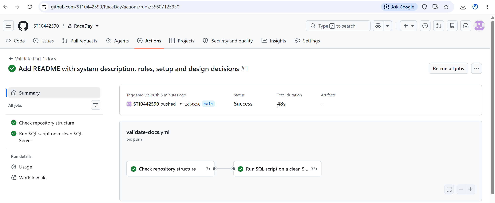
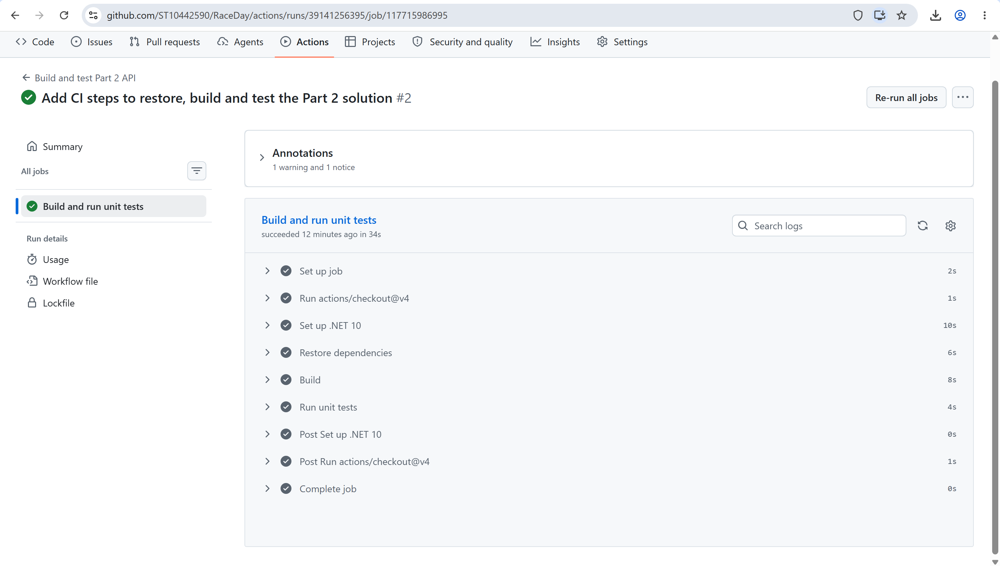

# RaceDay

RaceDay is a web-based event management system for the South African road running, walking and cycling community. Organisers create and manage events, categories and results; participants browse upcoming events, enter them, track their personal results, and check live weather and route information before race day.

This repository is built in three parts for PROG6212 (Programming 2B):

| Part | Scope | Status |
|---|---|---|
| 1 | System planning: ERD, API endpoint plan, SQL database script | ✅ Complete |
| 2 | RESTful API in C#, session authentication, unit tests, GitHub Actions CI | ✅ Complete |
| 3 | MVC web app, Azure Blob Storage, Docker | ⏳ |

## Roles

**Organiser** – registers an account; creates, edits and deletes their own events; manages each event's age and distance categories; views everyone enrolled in their events; captures and corrects participant results.

**Participant** – registers an account; browses and filters events; enters an event by choosing a category; views their own enrolments; tracks their personal finish times and positions; manages their profile.

An Organiser can only manage events they created. Attempting to change another Organiser's event returns **403 Forbidden**.

## Repository structure

```
/docs                        Part 1 planning documents
  RaceDay_ERD.png            Entity Relationship Diagram
  API_Endpoint_Plan.md       Every planned endpoint with role, body and responses
  RaceDay.sql                Creates RaceDayDB, all tables, constraints and seed data
  ci-green-build.png         Part 1 CI screenshot
  ci-part2-green-build.png   Part 2 CI screenshot

/Part2-API                   Part 2 solution
  RaceDay.Part2.slnx
  RaceDay.Api/               ASP.NET Core Web API
    Controllers/             Auth, Users, Events, Categories, Enrolments, Results, EventTypes
    Data/                    DbContext, design-time factory, seed data
    Migrations/              EF Core Code-First migrations
    Models/                  Entities and request/response DTOs
    Security/                Session helpers and the role filter
  RaceDay.Api.Tests/         25 xUnit tests

/.github/workflows
  validate-docs.yml          Checks /docs and runs the Part 1 SQL script on a clean SQL Server
  build-and-test.yml         Builds the Part 2 solution and runs all unit tests on every push
```

---

# Part 1 – System planning

## Setup

1. Install SQL Server (Developer or Express) and SQL Server Management Studio.
2. Open `docs/RaceDay.sql` in SSMS, connected to your server.
3. Press **Execute (F5)**. The script drops any existing `RaceDayDB`, recreates it, creates all 7 tables and a results view, and inserts the seed data.
4. The final two `SELECT` statements show row counts per table and the results board.

> **Note:** Part 2 manages `RaceDayDB` through EF Core migrations. Running the Part 1 script again will drop the database the API depends on. If you do, recreate it with `dotnet ef database update` from `Part2-API/RaceDay.Api`.

## Design decisions

- **7 entities:** Roles, Users, EventTypes, Events, EventCategories, Enrolments, Results.
- **Users ↔ EventCategories is many-to-many**, resolved by the `Enrolments` junction table, which records the Participant, the Event and the selected Category. A composite foreign key makes sure the category belongs to that event.
- **Results is one-to-zero-or-one with Enrolments**: a result can only exist for someone who entered.
- **Categories can be age-based or distance-based** (e.g. Under 20, Senior, 10km, 21km), set by `CategoryType`.
- **Organisers capture finish time and finishing position** in `Results`; DNF/DNS/DQ results have neither.
- **Lookup tables** (Roles, EventTypes) instead of free text keep values consistent.

### Differences between the ERD and the SQL script
None.

## CI/CD

The workflow checks that `/docs` holds the ERD, endpoint plan and SQL script, then starts a clean SQL Server 2022 container and runs `RaceDay.sql` to prove it executes without errors.



## Video presentation

Part 1 walkthrough: **https://youtu.be/9dK51eOxbsc**

---

# Part 2 – RESTful API

## Technology

- ASP.NET Core Web API (.NET 10) with controllers
- Entity Framework Core 10, Code-First, against SQL Server
- Server-side session authentication with ASP.NET Core Identity password hashing
- Swagger (Swashbuckle) for browsing and testing every endpoint
- xUnit with the EF Core in-memory provider for unit tests

## Setup and run

**Prerequisites:** .NET 10 SDK, SQL Server (Express or Developer), and the EF Core tools (`dotnet tool install --global dotnet-ef`).

1. Check the connection string in `Part2-API/RaceDay.Api/appsettings.json`. The default is:
```
   Server=.\SQLEXPRESS;Database=RaceDayDB;Trusted_Connection=True;TrustServerCertificate=True
```
2. Create the database from the migrations:
```
   cd Part2-API/RaceDay.Api
   dotnet ef database update
```
3. Run the API:
```
   dotnet run
```
4. Open the Swagger UI at the address shown in the console, with `/swagger` on the end — for example `http://localhost:5120/swagger`.

The database is seeded on first run with 2 organisers, 3 participants, 3 events, 7 categories, 6 enrolments and 3 results.

**Demo accounts** — every seeded account uses the password `RaceDay#2026`:

| Role | Email |
|---|---|
| Organiser | `lerato.mokoena@raceday.co.za` |
| Organiser | `johan.vanwyk@raceday.co.za` |
| Participant | `sipho.dlamini@gmail.com` |
| Participant | `aisha.patel@outlook.com` |
| Participant | `thandi.nkosi@gmail.com` |

**Organiser invite code:** `RACEDAY-ORG-2026` (set in `appsettings.json` under `RaceDay:OrganiserInviteCode`).

## Trying the API in Swagger

Swagger holds the session cookie between calls, so the sequence below works end to end:

1. `POST /api/auth/login` with an email and password from the table above.
2. `GET /api/auth/session` — returns the user id and role held in the session.
3. `GET /api/events/mine` — as an Organiser, lists only their own events.
4. `DELETE /api/events/2` as Lerato — returns **403**, because event 2 belongs to Johan.
5. `POST /api/auth/logout`, then any protected endpoint — returns **401**.

## Authentication and role-based access

The brief and the Part 2 rubric call for session management rather than tokens, so:

- **Login** verifies the password and stores the user's id and role in a server-side session. The browser only receives an opaque, HttpOnly cookie; no user data travels in it.
- **Passwords** are hashed with `PasswordHasher<User>` (PBKDF2). The plain text is never stored, and a unit test asserts this.
- **`[RequireRole]`**, a custom authorisation filter in `Security/RequireRoleAttribute.cs`, protects every non-public endpoint. With no roles listed it allows any logged-in user; with roles listed it allows only those. It returns **401** when nobody is logged in and **403** for the wrong role.
- **Ownership** is checked separately from role: an endpoint may allow all Organisers, then compare the event's `OrganiserId` against the session before allowing a change.
- **Organiser registration** requires an invite code, so event management cannot simply be claimed by anyone registering. Participant registration is open.

### Deviation from the Part 1 plan
The Part 1 endpoint plan specified JWT bearer tokens. Part 2 uses server-side sessions instead, to meet the requirement that *"the application must make use of session management to maintain the user's authenticated state and role"*. The endpoints, roles and status codes are otherwise as planned.

## Endpoints

All routes are under `/api`. Full details, including request bodies and failure codes, are in [`docs/API_Endpoint_Plan.md`](docs/API_Endpoint_Plan.md) and in the Swagger UI.

| Area | Endpoints |
|---|---|
| Authentication | `POST /auth/register`, `POST /auth/login`, `POST /auth/logout`, `GET /auth/session` |
| User profile | `GET /users/me`, `PUT /users/me`, `PUT /users/me/password` |
| Event types | `GET /event-types` |
| Events | `GET /events`, `GET /events/{id}`, `GET /events/mine`, `POST /events`, `PUT /events/{id}`, `DELETE /events/{id}` |
| Categories | `GET /events/{eventId}/categories`, `GET /categories/{id}`, `POST /events/{eventId}/categories`, `PUT /categories/{id}`, `DELETE /categories/{id}` |
| Enrolments | `POST /enrolments`, `GET /enrolments/me`, `DELETE /enrolments/{id}`, `GET /events/{eventId}/enrolments` |
| Results | `POST /results`, `PUT /results/{id}`, `DELETE /results/{id}`, `GET /events/{eventId}/results`, `GET /results/me` |

## Business rules enforced by the API

- An Organiser may only change events, categories and results belonging to their own events.
- A Participant may enter each event only once.
- The chosen category must belong to the chosen event, enforced by a composite foreign key as well as by the API.
- A Participant's age on race day must fall inside an age category's range.
- A category cannot be entered once it is full, or after the registration deadline.
- A Finished result needs both a finish time and a finishing position; DNF, DNS and DQ results have neither.
- An event with confirmed enrolments cannot be deleted; its status is set to Cancelled instead.

## Running the tests

```
cd Part2-API
dotnet test
```

25 xUnit tests cover both success and failure paths:

| Area | Covered |
|---|---|
| Registration | valid participant, password hashed not stored, duplicate email rejected, organiser without invite code rejected, organiser with invite code accepted |
| Login | correct password starts a session holding the user and role, wrong password rejected with no session, unknown email rejected, logout clears the session |
| Event management | create saves against the logged-in Organiser, deadline after event date rejected, unknown event type rejected, `GET /events/mine` only returns own events, unknown id returns 404 |
| Role and ownership | updating another Organiser's event returns 403 and leaves it unchanged, deleting another Organiser's event returns 403, viewing another Organiser's enrolments returns 403, cancelling someone else's enrolment returns 403 |
| Enrolments | valid entry records Participant, Event and Category; second entry into the same event rejected; category from a different event rejected; age outside the category range rejected; full category rejected |

Each test builds its own in-memory database and a fake session, so tests are isolated and need no SQL Server. The in-memory provider does not enforce database check constraints, so these tests prove the API's own validation; the constraints themselves are defined in the migration and in `docs/RaceDay.sql`.

## CI/CD

`build-and-test.yml` restores, builds and runs all 25 unit tests on every push to `main`.



## Video presentation

Part 2 walkthrough: **[YouTube link – add here]**